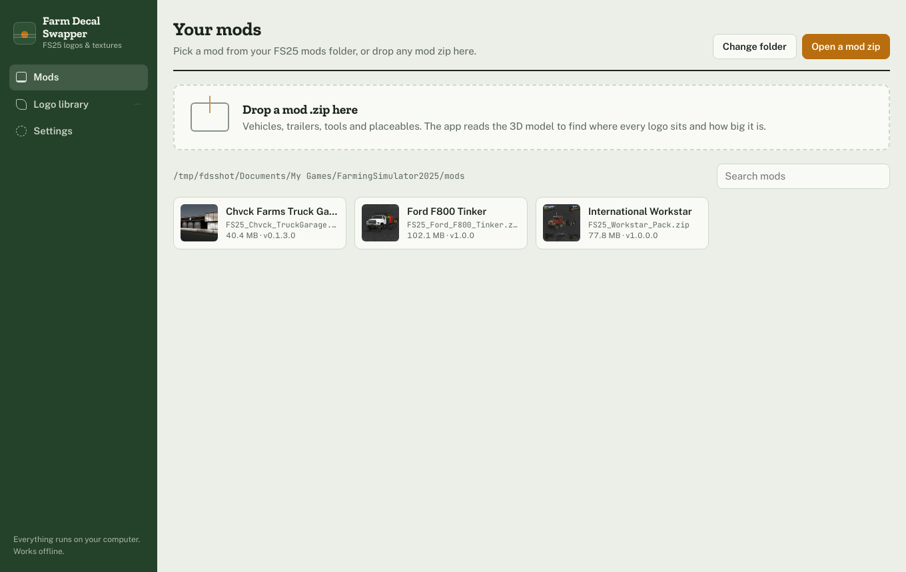
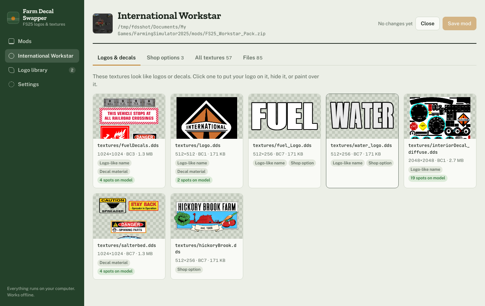
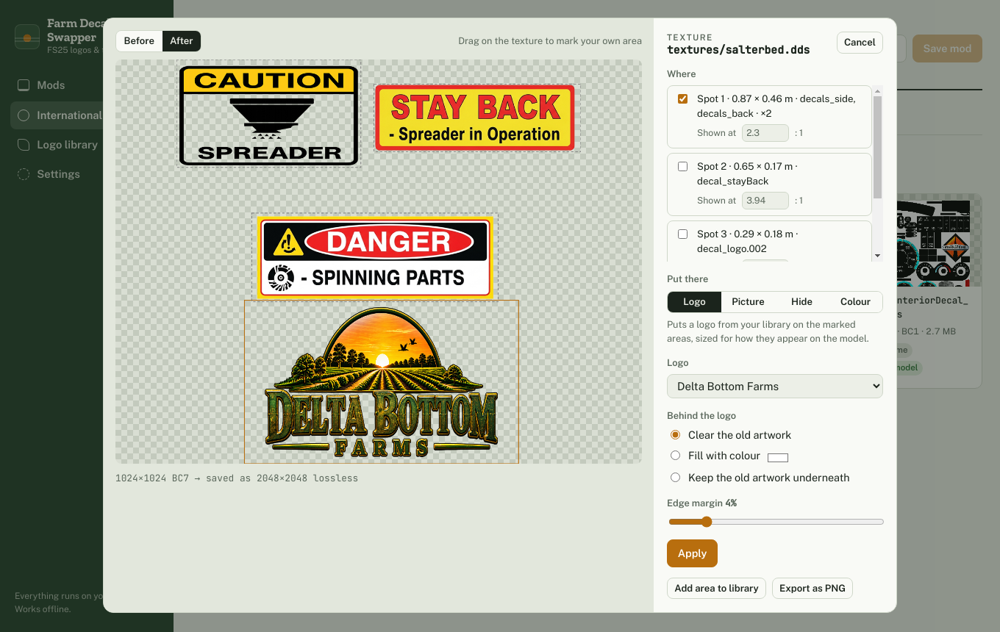
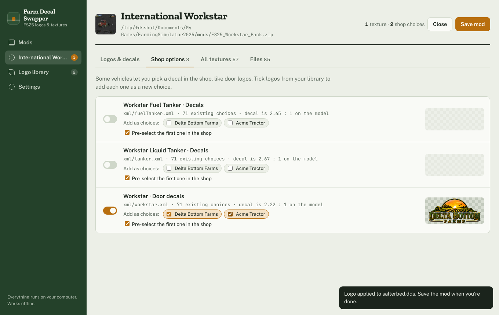
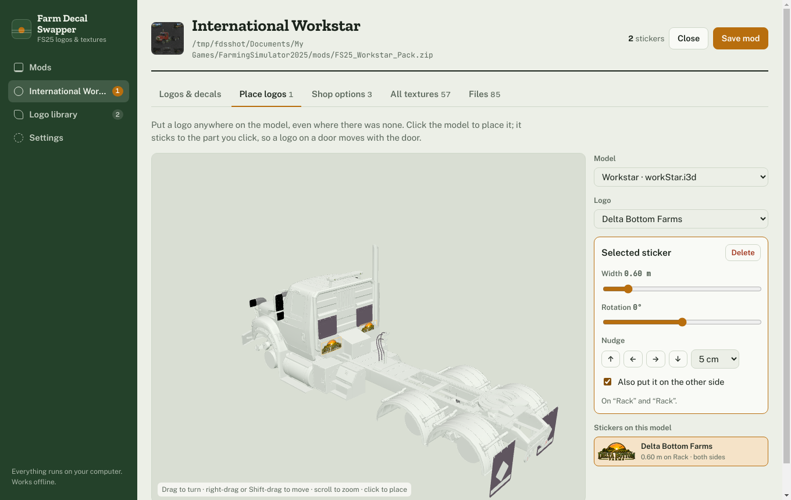
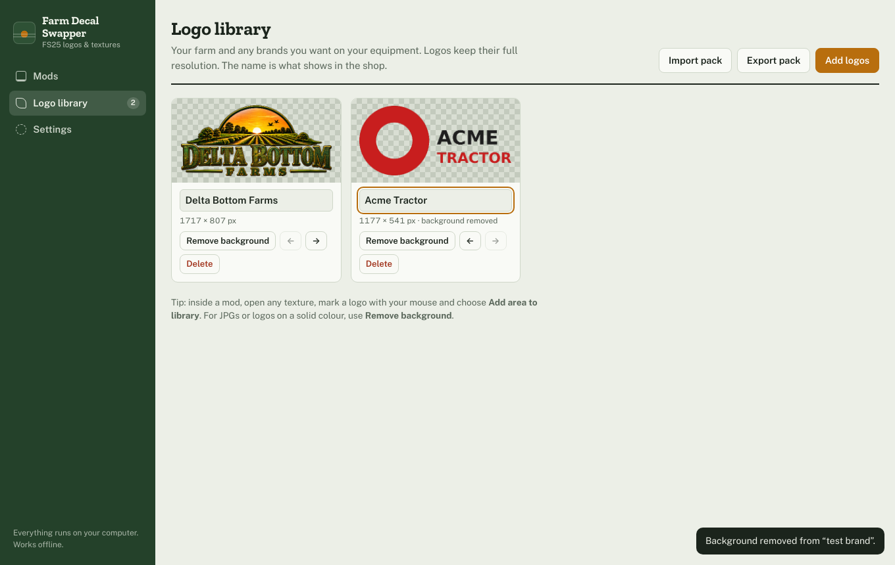
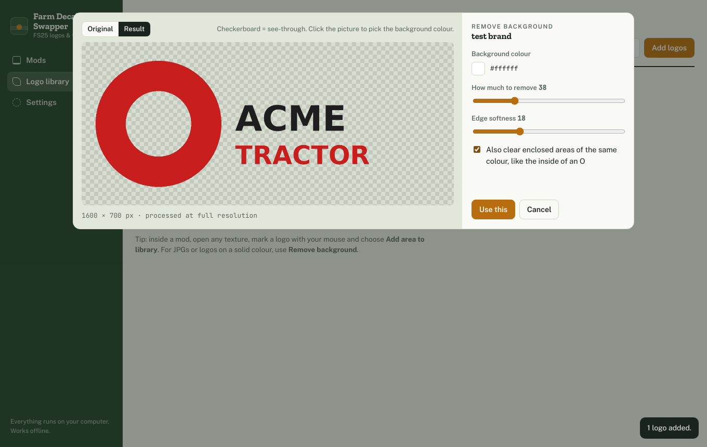
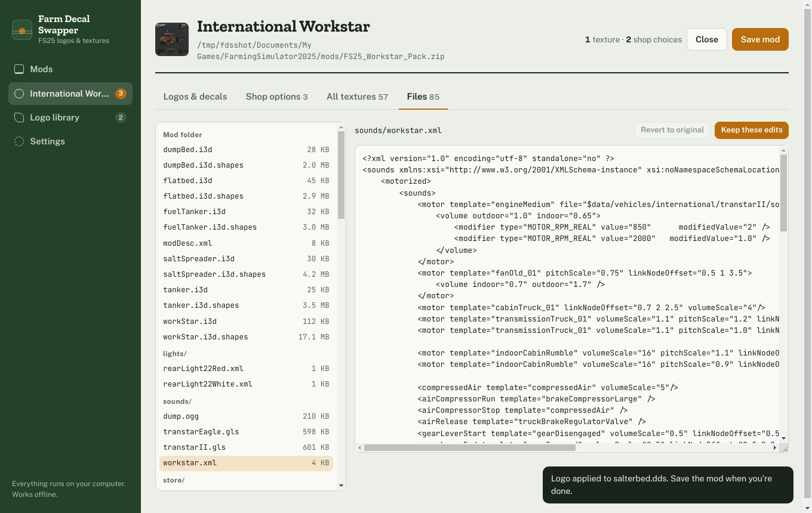

# Farm Decal Swapper

Put your farm logo on Farming Simulator 25 mods, swap or hide any texture, and add your own brand choices to the shop. You don't need GIANTS Editor, Blender or an image editor.



## What it does

- **Finds the logos for you.** Open a vehicle, trailer or placeable and the app reads its 3D model. It shows which textures are logos or decals, where each one sits, and how big it is in metres.
- **Puts your logo on them, sized correctly.** Decals are often stretched on the model. The app corrects for that, so your logo comes out with the right proportions.
- **Adds logos where there were none.** Open the 3D view, click anywhere on the model and a logo sticker lands right there. Set its size and angle, nudge it into place, and tick one box to put a matching one on the other side.
- **Adds shop choices.** Many vehicles have a decal option in the shop, like door logos. You can tick any logos from your library to add each one as a new choice, and pre-select one.
- **Swaps, hides or paints any texture.** Replace part or all of a texture with a picture, make a decal see-through, or paint it one flat colour.
- **Keeps a logo library.** It holds as many logos as you like, at full resolution. If a logo comes on a white or solid background, the app can remove it. You can also save a logo you find inside a mod straight into your library.
- **Edits mod files.** Browse every file in a mod and edit the XML in a text view. The app won't keep XML that the game couldn't load.
- **Keeps quality high.** By default textures are saved without compression loss, and small decals are enlarged up to 2048 px.
- **Backs up before saving.** It copies the original mod before saving over it.
- **Works offline.** Nothing is uploaded, and it needs no account.

| Logos & decals | Texture editor | Shop options |
|---|---|---|
|  |  |  |



| Logo library | Remove background | Files |
|---|---|---|
|  |  |  |

## Install (Windows)

1. Download **Farm-Decal-Swapper-win-x64.zip** from the [Releases](../../releases) page.
2. Unzip it anywhere, for example into `Documents\Farm Decal Swapper`.
3. Run **Farm Decal Swapper.exe**.

The app isn't code-signed, so Windows SmartScreen may say *Windows protected your PC*. Click **More info**, then **Run anyway**.

## How to use it

1. **Add your logos.** Go to **Logo library**, click **Add logos** and pick PNGs. A PNG with a see-through background works best. For a JPG or a logo on a solid colour, click **Remove background**. The logo's name is what shows in the shop.
2. **Open a mod.** The **Mods** screen lists your FS25 mods folder (`Documents\My Games\FarmingSimulator2025\mods`). Click a mod, or drop any mod zip on the window.
3. **Change it.**
   - **Logos & decals**: click a texture and choose *Logo*, *Picture*, *Hide* or *Colour*. Tick the spots on the model you want to change, or drag a box over any area. Then click **Apply**.
   - **Place logos**: pick a model and a logo, then click the model where you want the logo. Drag to turn the view, right-drag to move it, scroll to zoom. Use the sliders and arrows to size and position it. Tick **Also put it on the other side** for a matching sticker on the far side.
   - **Shop options**: tick logos to add them as choices in the vehicle's decal menu.
   - **All textures**: does the same as *Logos & decals*, for every texture in the mod.
   - **Files**: edit XML such as the store name or price, then click **Keep these edits**.
4. **Save the mod.** The app suggests saving over the original. A backup goes to `Documents\Farm Decal Swapper\Backups` first.
5. **Start the game.** New shop choices appear at the end of the list in the configure screen.

### Good to know

- **Hidden decals that show black in game:** some models don't support see-through on that part. Open the texture again and use **Colour** to match the paint instead.
- **Placed logos:** each one is a thin sticker that sits 4 mm off the part you clicked, so it moves with that part (a logo on a door opens with the door). It always shows; it isn't a shop choice. On strongly curved parts, keep it small or it may float off the edges.
- **Quality:** *Settings → Texture quality* switches between **Best** (no loss, a few MB per logo texture) and **Smaller files** (DXT5).
- **Moving your library:** **Export pack** saves your logo library as one zip, and **Import pack** loads it on another PC.
- **Mod authors' work:** patch mods for your own use. Don't re-upload someone else's mod without their permission.

## Brand logos and trademarks

The app ships with **no** brand logos. Farm and brand logos you add stay on your computer. Brand names and logos belong to their owners. Farm Decal Swapper is not affiliated with GIANTS Software or any equipment maker.

## Build from source

You need [Node.js](https://nodejs.org/) 20 or newer.

```bash
npm install
npm start              # run the app
npm test               # core tests
npm run dist           # package for Windows into dist/
npm run build:web      # single-file browser version in dist/farm-decal-swapper.html
```

To build a copy with your own logos already in the library:

```bash
node scripts/make-seed.js personal/seed.js "My Farm=path/to/logo.png"
node scripts/package-win.js --seed personal/seed.js
```

Pushing a tag like `v1.0.0` runs the GitHub Actions workflow. It builds the Windows zip and attaches it to a release.

### How it works

- `src/core.js` decodes and writes DDS textures (BC1, BC2, BC3, BC7 and uncompressed). It reads `.i3d` scenes and decrypts `.i3d.shapes` geometry, so it knows which part of each texture appears on the model and at what size. For placed logos it writes new sticker shapes into `.i3d.shapes` and adds them to the scene. It also finds shop decal options in vehicle XML.
- `src/viewer.js` shows the model in 3D with three.js.
- `src/app.js` is the interface. `electron/` is the desktop shell, which only reads and writes files when you ask it to.

## License

MIT. See [LICENSE](LICENSE) and [THIRD_PARTY_NOTICES.md](THIRD_PARTY_NOTICES.md).
